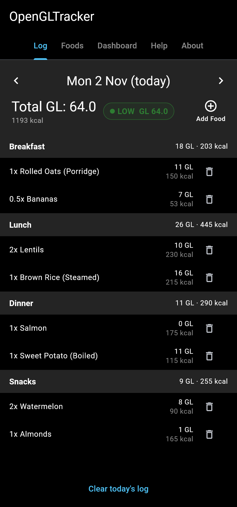
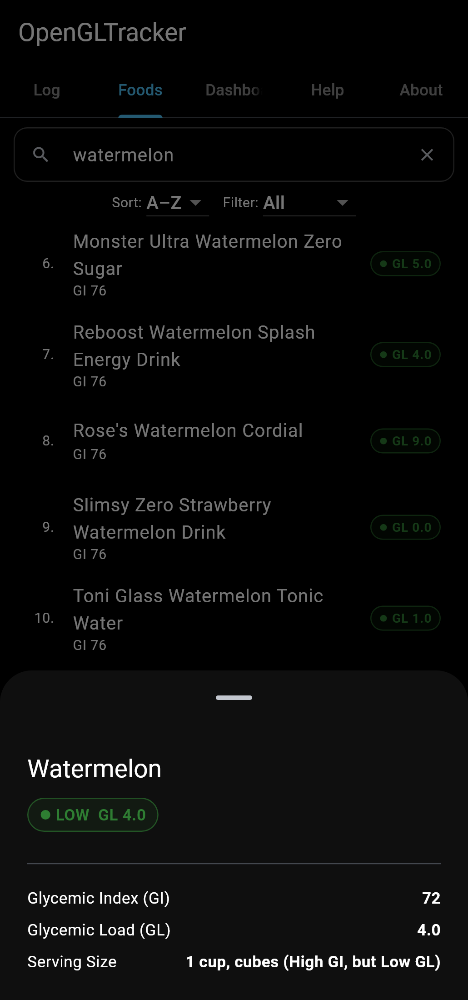
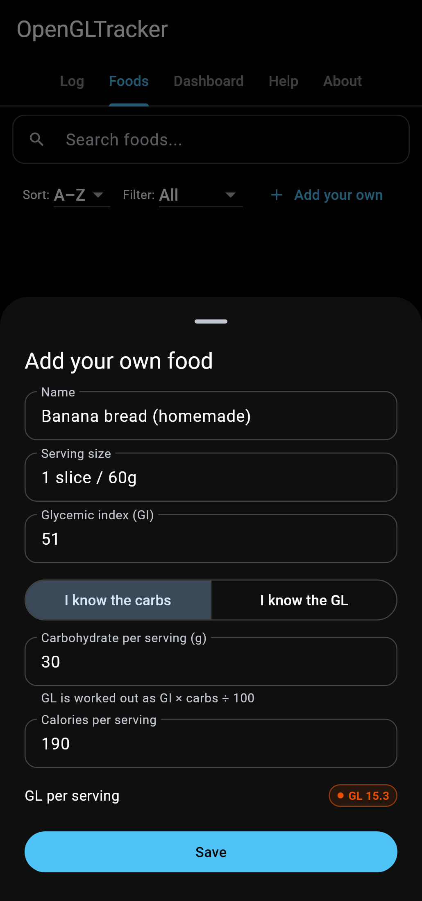
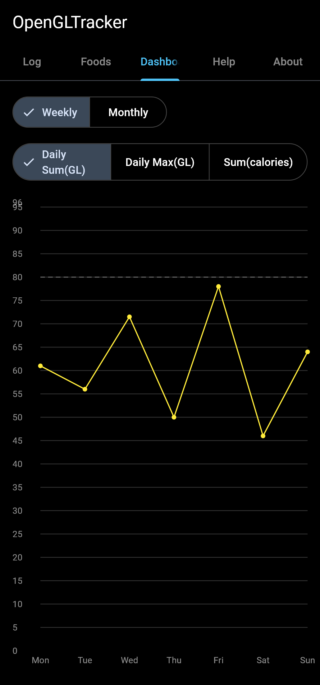
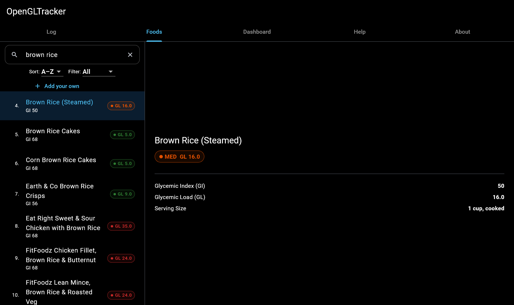

# OpenGLTracker

[](https://github.com/riazhassan-za/opengltracker/actions/workflows/ci.yml)
[](LICENSE)

Track the **glycemic load** of what you eat, per meal and per day.

## Why glycemic load, not just glycemic index

Most low-carb and "low GI" diets judge a food by its **glycemic index (GI)**. GI is a 0–100 score for how quickly a food's carbohydrate raises blood sugar compared with pure glucose. GI on its own is misleading because it says nothing about *how much* carbohydrate you actually eat. GI is measured using a fixed amount of available carbohydrate (usually 50 g), not a realistic portion. A food can score high on GI and still hardly move your blood sugar if a normal serving contains little carbohydrate. Portion size and quantity are everything.

**Glycemic load (GL)** takes portion size into account: `GL = GI × grams of carbohydrate in the serving ÷ 100`. Watermelon is the classic example. Its GI is high (about 72–80), but a cup holds so little carbohydrate that its GL is only about 4–5, which is low [[1]](#sources). The reverse also holds: a "healthy" low-GI food eaten in large quantities can add up to a high load. GL is the better predictor of real-world blood-sugar impact. In the long-running Nurses' Health Study, a high dietary glycemic load was associated with a greater risk of type 2 diabetes [[3]](#sources).

Thinking in GL widens the menu. Fruit, root vegetables, some breads and other foods that a strict low-GI diet tells you to avoid can still fit, **in the allowable quantity**. OpenGLTracker is built around this idea. Look up a food, see its GL for a typical serving, choose how many portions you'll have, and watch the running total for each meal and for the whole day. The goal is to help you limit and track glycemic load, not to make you give up foods you enjoy.

As a secondary feature, the app also adds up **calories** per meal and per day. That's a convenience; the main focus is glycemic load.

## Features

- **Food browser:** search more than 5,000 foods, sort by GL, GI or name, and filter by GL tier. Each food shows its GI, GL, calories and typical serving.
- **Your own foods:** add foods that aren't in the database. Enter the GI and either the carbs per serving (the app works out the GL) or the GL itself. Your foods show up alongside the rest, and you can edit or delete them.
- **Daily log:** add foods with a portion count, grouped by meal (breakfast, lunch, dinner, snacks). GL and calorie totals are shown per meal and per day. Drag entries between meals (long-press on mobile).
- **Dashboard:** charts of daily total GL, highest single-meal GL, and calories over time. Tap a day to open its log.
- **Offline and private:** the food database is bundled with the app, and your log and your own foods are stored only on your device.

### Screenshots

<p align="center">
  
  
  
  
</p>

<p align="center">
  
</p>

Screenshots are generated from the real app with `flutter test screenshots/readme_screenshots_test.dart` (run from `app/`).

### GL classification used in the app

| Per serving | Per day     | Class  |
|-------------|-------------|--------|
| ≤ 10        | ≤ 80        | Low    |
| 11–19       | 81–120      | Medium |
| ≥ 20        | > 120       | High   |

The per-serving bands are the commonly used ones [[1]](#sources)[[2]](#sources).

## Download

Get the latest build from the [releases page](https://github.com/riazhassan-za/opengltracker/releases/latest):

- **Android:** `OpenGLTracker-android.apk`. Allow installs from unknown sources, then open the file.
- **Web:** `OpenGLTracker-web.zip` is a static site. Unzip it and serve the folder from any web server.

Each release includes a `SHA256SUMS.txt` for checking your download.

## Building from source

OpenGLTracker is a [Flutter](https://flutter.dev) app that runs on the web and on Android from a single codebase.

```sh
cd app
flutter pub get
flutter run -d chrome     # web
flutter run -d android    # Android device/emulator
flutter test
```

The food database is `app/db/FoodsList.csv`, with the columns: food item, GI, GL, calories per portion, and typical serving. Rows whose serving notes contain `(GI/GL unavailable)` are skipped.

## Disclaimer

OpenGLTracker is an informational tool, not medical advice. GI and GL values are approximate and vary with ripeness, preparation and the individual. If you have diabetes or another medical condition, talk to your doctor or a registered dietitian before changing your diet.

## Donate

Tired of being ripped off for basic software that should be free? Send
donations to help fund ad-free/subs-free software for great justice.

Send Bitcoin:

[`bc1q4jp3gvatpmmd8qh6neejay4z05qawuneqrr92t`](bitcoin:bc1q4jp3gvatpmmd8qh6neejay4z05qawuneqrr92t)

There is no paid tier, no ads, no telemetry and nothing withheld. The app makes
no network connections, and your food log never leaves your device.

## License

GPL-3.0-or-later. See [LICENSE](LICENSE).

## Sources

1. Harvard Health Publishing, *The lowdown on glycemic index and glycemic load*. https://www.health.harvard.edu/diseases-conditions/the-lowdown-on-glycemic-index-and-glycemic-load
2. Atkinson FS, Brand-Miller JC, Foster-Powell K, Buyken AE, Goletzke J. *International tables of glycemic index and glycemic load values 2021: a systematic review.* Am J Clin Nutr. 2021;114(5):1625–1632. PMID 34258626.
3. Salmerón J, Manson JE, Stampfer MJ, Colditz GA, Wing AL, Willett WC. *Dietary fiber, glycemic load, and risk of non-insulin-dependent diabetes mellitus in women.* JAMA. 1997;277(6):472–477.
